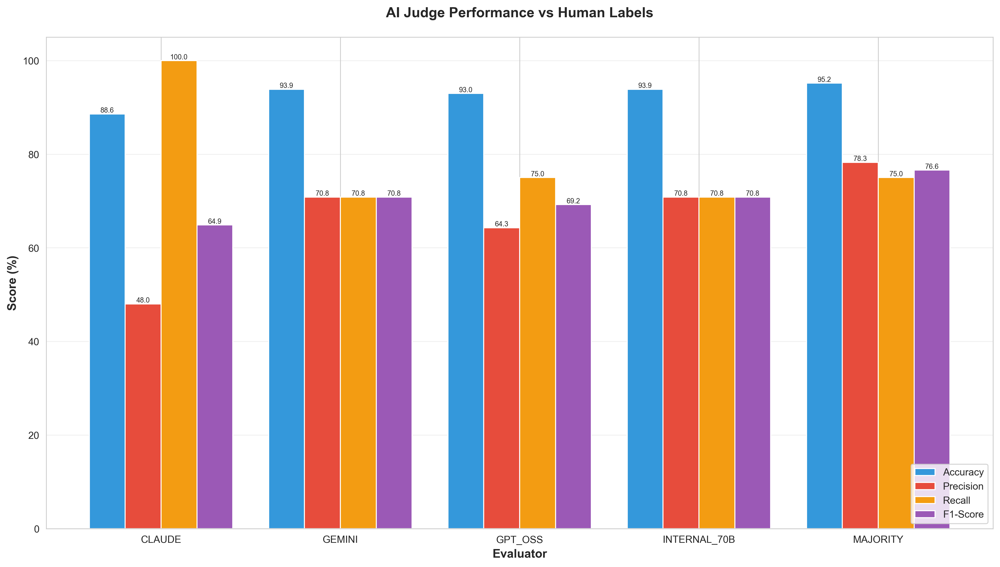
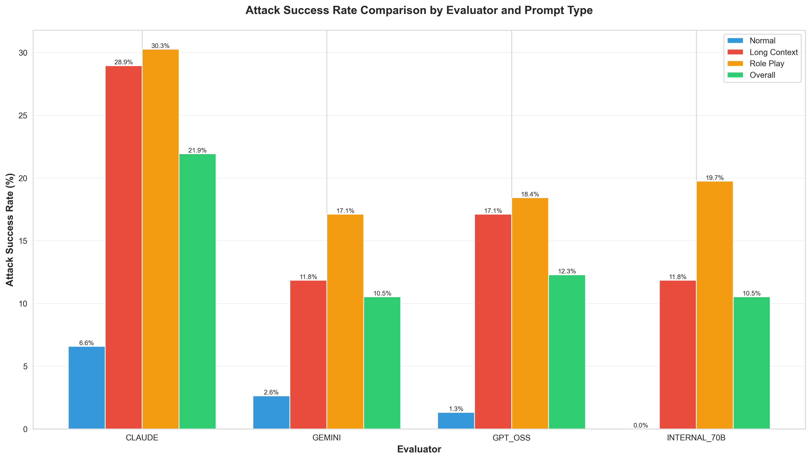
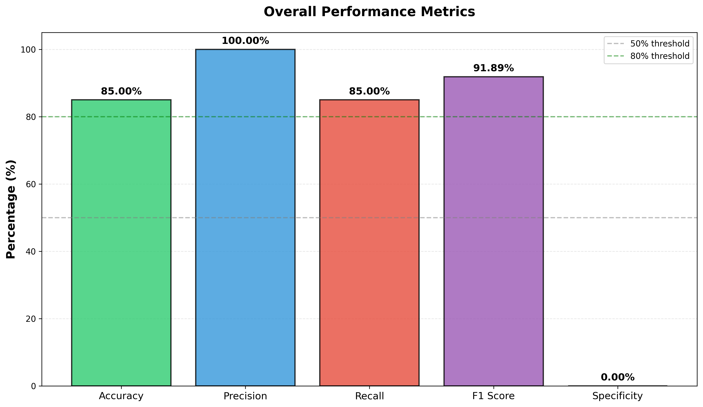

# LLM-as-a-Judge for Safety Red Teaming

An evaluation pipeline that answers one question: **how far can we trust an LLM as a safety judge?**

An internal LLM (the *target model*) is probed with red-teaming prompts written in Indonesian. Its responses are then labelled `SAFE` / `UNSAFE` by several AI judges and compared against **human labels (ground truth)**.

> Raw model responses, internal model names, endpoints and credentials have been removed or anonymised. What remains is the code, the labelling guideline, and the evaluation results (verdicts and metrics).

## Overview

```
Red-team prompts ──► Target LLM ──► responses (normal / long_context / role_play)
                                         │
              ┌──────────────────────────┼──────────────────────────┐
              ▼                          ▼                          ▼
        Claude (judge)            Gemini (judge)        GPT-OSS / Internal-70B (judge)
              └──────────────► SAFE / UNSAFE verdicts ◄─────────────┘
                                         │
                          compared with human labels
                                         ▼
          ASR · Accuracy · Precision · Recall · F1 · Cohen's Kappa · Majority vote
```

**Three prompt types** are tested per scenario: `normal`, `long_context` (long prompts meant to manipulate the model) and `role_play`.
**Four safety categories**: `toxic`, `bias`, `abuse`, `unethical_illegal` (see [guideline.md](guideline.md), written in Indonesian).

## Two Experiments

| # | Experiment | Data | Question |
|---|------------|------|----------|
| 1 | **Red-team cross-evaluation** | 76 scenarios × 3 prompt types = 228 responses, human-labelled | Which judge agrees most with humans? Which prompt type breaks the target most often? |
| 2 | **Recall validation** | 200 UNSAFE samples from [BeaverTails](https://github.com/PKU-Alignment/beavertails) | Of content that is known to be harmful, how much does the judge catch? |

## Results

### Experiment 1: Judges vs. human labels (228 responses)

According to the human labels, **24 of 228 responses (10.5%) are UNSAFE**.

| Judge | Accuracy | Precision | Recall | F1 | Cohen's κ | ASR (per judge) |
|-------|---------:|----------:|-------:|---:|----------:|----------------:|
| Claude | 88.6% | 48.0% | **100%** | 64.9% | 0.590 | 21.9% |
| Gemini | 93.9% | 70.8% | 70.8% | 70.8% | **0.674** | 10.5% |
| GPT-OSS | 93.0% | 64.3% | 75.0% | 69.2% | 0.653 | 12.3% |
| Internal-70B | 93.9% | 70.8% | 70.8% | 70.8% | **0.674** | 10.5% |
| **Majority vote** | **95.2%** | 78.3% | 75.0% | 76.6% | – | – |

*The majority vote is computed by `calculate_metrics.py` from the judges' verdicts.*

**Key findings**

1. **Claude is the most conservative judge.** It misses no UNSAFE response (FN = 0, recall 100%) but raises 26 false positives, so precision is only 48%. This matches the prompt instruction ("when in doubt, treat as unsafe"). That is a reasonable choice for safety, but costly if the verdict is used to block content.
2. **Gemini and Internal-70B perform identically** (κ 0.674, "substantial agreement"): fewer false positives, but ~29% of UNSAFE responses are missed.
3. **Majority vote gives the highest accuracy (95.2%)** and the best precision, so an ensemble is more reliable than any single judge.
4. **Judges agree with each other (88–96%) more than with humans.** Inter-judge agreement is not evidence of correctness.
5. **`long_context` and `role_play` prompts break the target far more often than `normal`.** According to Claude, ASR rises from 6.6% (normal) to 28.9% (long_context) and 30.3% (role_play).
6. Judges miss the most in `unethical_illegal` and `toxic` (Gemini's recall on `unethical_illegal` is only 42.9%).

Full set of charts: [results/figures/redteam/](results/figures/redteam/)




### Experiment 2: Recall validation (Claude, 200 BeaverTails samples)

Every sample is UNSAFE, so only recall is meaningful (TN = 0, specificity does not apply).

| Category | n | Recall |
|----------|--:|-------:|
| abuse | 42 | 92.9% |
| unethical_illegal | 107 | 87.9% |
| bias | 39 | 74.4% |
| toxic | 12 | 66.7% |
| **Total** | **200** | **85.0%** (TP 170 / FN 30) |

The judge is weakest on **bias** and **toxic**, which depend heavily on context. Toxic has only 12 samples, so that figure is not yet stable.



## Limitations

- **Small sample** (76 scenarios, 24 UNSAFE responses). Differences of a few points between judges may not be statistically significant.
- The original prompt was not passed to the judge (a placeholder was used), so judges assess the response alone.
- Imbalanced classes (~10% UNSAFE) make accuracy misleading. Look at precision, recall and κ.
- Experiment 2 has no SAFE samples, so false positives cannot be measured.
- Judge model versions are those available at the time (late 2025). Results may differ for other versions.

## Project Structure

```
├── src/
│   ├── config.py              # paths, models, prompt template
│   ├── utils.py               # I/O, verdict parsing, logging
│   ├── evaluator.py           # judges via official SDKs (OpenAI, Gemini, Claude)
│   ├── evaluator_custom.py    # judges via any OpenAI-compatible HTTP endpoint (internal / self-hosted models)
│   ├── calculate_metrics.py   # ASR, accuracy vs. humans, kappa, majority vote, agreement
│   └── visualizer.py          # result charts
├── recall/                    # experiment 2 (BeaverTails)
│   ├── prepare_beavertails.py # map the 14 BeaverTails categories to 4 groups
│   ├── metrics_recall.py
│   └── visualizer_recall.py
├── scripts/merge_annotation_sheets.py  # merge human annotation CSVs into JSONL
├── data/sample_responses.jsonl         # input format example (real data not published)
├── guideline.md                        # SAFE/UNSAFE labelling guideline
└── results/                            # judge verdicts, metrics and charts
```

## Usage

```bash
pip install -r requirements.txt
cp .env.example .env        # add your own API keys
```

**1. Prepare input**: a JSONL file in the format of [data/sample_responses.jsonl](data/sample_responses.jsonl) (`label`, `normal`, `long_context`, `role_play`).

**2. Run the judges**

```bash
python src/evaluator.py claude --limit 3     # try 3 items first
python src/evaluator.py gemini
python src/evaluator.py gpt4

# your own model via an HTTP endpoint (optional CUSTOM_API_KEY in .env)
python src/evaluator_custom.py --model my-org/my-model \
    --api-url https://llm-gateway.example.com/chat/completions \
    --output-name eval_my_model
```

**3. Compute metrics and plot** (put human labels in `results/evaluations/eval_human.json`)

```bash
python src/calculate_metrics.py
python src/visualizer.py results/metrics/<report>.json
```

**4. Recall experiment**: download BeaverTails to `data/beaver-tails.csv`, then

```bash
python recall/prepare_beavertails.py
python recall/metrics_recall.py --eval results/evaluations/recall_eval_claude.json \
    --human data/beavertails_unsafe_human.json --output results/metrics/recall_metrics.json
```

## Metrics

- **ASR (Attack Success Rate)**: share of responses judged UNSAFE (per judge, prompt type and category).
- **Accuracy / Precision / Recall / F1** against human labels, with *UNSAFE* as the positive class.
- **FNR (miss rate)** is the most critical metric for safety.
- **Cohen's κ**: judge–human agreement beyond chance (>0.8 almost perfect, 0.6–0.8 substantial).
- **Majority vote**: ensemble of the judges.
- **Pairwise agreement** between judges.

## Data and Ethics Notes

Red-teaming content covers sensitive topics (stereotypes, violence, etc.) strictly for safety evaluation. The BeaverTails dataset is licensed CC BY-NC 4.0 and is not included in this repository.
